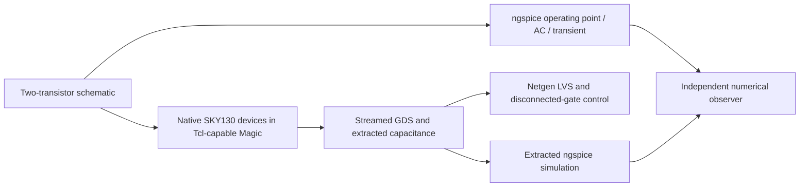

# SKY130 inverter-amplifier demonstration

An externally biased, two-transistor CMOS inverter amplifier, simulated and laid out with SKY130. The local TT run at 27 C, 1.8 V and a 100 fF load measured approximately 135.86 V/V gain at 1 kHz. Magic reported zero DRC errors, and Netgen matched two devices and four nets. Capacitance-extracted simulation agreed with the schematic; corrupted-waveform and disconnected-gate controls were rejected.

- [Quick start](#quick-start)
- [How it works](#how-it-works)
- [What runs](#what-runs)
- [Repository layout](#repository-layout)
- [Individual stages](#individual-stages)
- [Results and controls](#results-and-controls)
- [Troubleshooting](#troubleshooting)
- [Reports and limits](#reports-and-limits)
- [Licence](#licence)

The implementation and whitepaper were locally verified on 27 October 2026. **Crucible is beta.** These are bounded engineering demonstrations, with the exclusions below.

## Included files

`spice/amplifier.spice` defines the circuit. `layout/` generates native PDK devices and checks the connected layout. `scripts/prepare.py` builds SPICE testbenches; `route.py` connects the generated device terminals; `verify.py` independently measures the simulation tables and inspects GDS/LVS evidence.

The reviewed [PDF](docs/SKY130_Inverter_Amplifier_SPICE_to_GDS_Ignytion_A4.pdf) and [editable A4 PowerPoint](docs/SKY130_Inverter_Amplifier_SPICE_to_GDS_Ignytion_A4.pptx) are included. [Compact evidence](evidence/summary.json) records measured outcomes; [document hashes](evidence/documents.sha256.json) bind the final copies. Generated build artifacts and raw logs remain local and are excluded from Git.

## Quick start

Open a Linux/WSL terminal in this repository root. Crucible is beta. A complete SKY130A PDK, a separately supplied Tcl-capable Magic payload, compatible GLU/FFTW native libraries and network access for initial acquisition are required. The catalogued classic Magic payload does not supply the Tcl generator used by this layout. The project does not download a PDK or copy runtime libraries from another demo.

```sh
igny init
igny workspace sync
igny tool install make --version 4.4.1 --env analog-spice-gds
igny run --env analog-spice-gds make setup
igny run --env analog-spice-gds make check
```

Set AMPLIFIER_PDK and MAGIC_LOCAL to your complete PDK and Tcl-capable Magic roots. NGSPICE_RUNTIME_DIR and MAGIC_RUNTIME_DIR may name additional native-library directories. Use the ignored local.env.sh described by [config/example.env.sh](config/example.env.sh), or pass those values as Make variables. Replace every example path with a real dependency location.

Run the complete experiment after satisfying those prerequisites:

```sh
igny run --env analog-spice-gds make run AMPLIFIER_PDK=/path/to/sky130A MAGIC_LOCAL=/path/to/tcl-magic
```

Every executable example in this guide goes through Igny. Make delegates to the supplied stage scripts and observers; failed stages stop the workflow. Make 4.4.1 is installed separately from the existing engineering-tool lock. The setup target uses the Igny-launched Python interpreter to create an isolated environment in ignored build/observer-venv and install requirements.txt there, then checks the imported module locations. It does not change system Python or a shared tool payload. The check target checks observer imports; it does not qualify a PDK or native-library installation.

## How it works

The circuit is an externally biased CMOS inverter amplifier. Native PDK devices become layout geometry; Netgen compares extracted connectivity, while the observer compares schematic and capacitance-extracted responses. Decoded GDS, DRC, LVS and numerical checks are separate requirements.



## What runs

| Component | Pinned version |
|---|---|
| magic | 8.3.682 |
| netgen | 1.5.323 |
| ngspice | 46 |

The lock restores those engineering tools; the setup target prepares only project-local observer dependencies where needed. Initial acquisition may require network access. Native Windows/macOS/ARM tool execution and independent clean-machine reproduction are not established by these results.

## Repository layout

```text
.
|-- Makefile             Managed workflow entry points
|-- crucible.toml        Workspace selection
|-- crucible.lock        Engineering-tool identities
|-- spice/               Schematic circuit
|-- layout/              Native-device generation and layout checks
|-- scripts/             Managed workflow, numerical and physical observers
|-- config/              Example external dependency settings
|-- docs/                Reviewed PDF and editable PowerPoint
|-- evidence/            Compact reviewed measurement snapshots
`-- build/               Generated local artifacts; ignored by Git
```

## Individual stages

Run these from the same prepared workspace. Stages use earlier outputs; execute them in the listed order when reproducing the flow manually. The run target performs the full ordered workflow.

| Managed command | Work performed |
|---|---|
| `igny run --env analog-spice-gds make prepare` | Generate schematic testbenches from the configured PDK |
| `igny run --env analog-spice-gds make sim` | Run the DC sweep |
| `igny run --env analog-spice-gds make layout` | Generate/connect layout, check DRC, stream GDS and extract |
| `igny run --env analog-spice-gds make lvs` | Compare connectivity and reject a disconnected-gate reference |
| `igny run --env analog-spice-gds make characterise` | Run schematic/extracted operating point, AC and transient analyses |

Inspect or recheck existing results without rebuilding:

```sh
igny run --env analog-spice-gds make smoke
igny run --env analog-spice-gds make report
igny run --env analog-spice-gds make help
```

The smoke target validates existing generated evidence. It is not a new experiment run. The report target prints local summaries and fails if required results are absent. The sed target normalises only public shell inputs to LF; run invokes it automatically.

## Results and controls

Require AMPLIFIER_SIMULATION_VERIFIED_WITH_NEGATIVE_CONTROLS and AMPLIFIER_PHYSICAL_ARTIFACTS_VERIFIED. Recorded nominal gain is approximately 135.86 V/V at 1 kHz; the physical observer requires nonempty decoded GDS, zero reported DRC errors, unique two-device/four-net matching and extracted capacitance. Flat/non-inverting waveforms and the disconnected-gate reference must be rejected.

Expected negative failures are handled by the existing runners/observers. Missing tools, compilation failures, timeouts and missing artifacts do not count as successful controls. Changing sources or inputs requires rerunning the affected stages and their dependents. Raw logs and generated runtime/PDK payloads remain local.

## Troubleshooting

| Symptom | Check / next action |
|---|---|
| Wrong workspace or missing tool | Open the terminal in the root containing crucible.toml; use the explicit project environment in this guide and restore the lock. |
| Make is not bound | Repeat the managed Make installation in Quick start. |
| Observer dependency is absent or changed | Repeat the managed setup target; retain the pinned requirements. |
| Native library or PDK is missing | Supply the prerequisites described above. Lock restoration and observer setup do not provision them. |
| Evidence is missing or stale | Run the full workflow or the affected stages in order. Preserve the reported failure instead of editing expected values. |
| Negative control unexpectedly passes | Treat the guard as failed and inspect its artifacts. |

## Reports and limits

Read the [technical report](docs/SKY130_Inverter_Amplifier_SPICE_to_GDS_Ignytion_A4.pdf) or its [editable PowerPoint](docs/SKY130_Inverter_Amplifier_SPICE_to_GDS_Ignytion_A4.pptx). The documents record measured results and exclusions; source commands in this README are the current managed workflow.

One TT/27 C/1.8 V biased two-transistor example with a 100 fF load. It does not establish PVT, noise, mismatch, parasitic-resistance signoff, robust bias generation, fabrication or silicon performance.

Review the source/document package locally with:

```sh
igny run --env analog-spice-gds make preflight
```

This checks the public candidate and document hashes; it does not publish anything or rerun engineering verification.

## Licence

Dependencies retain their upstream licences and credit. This checkout has no project-wide licence grant; the owner must select the intended project licence before presenting it as an open-source release. No upstream endorsement is implied.
